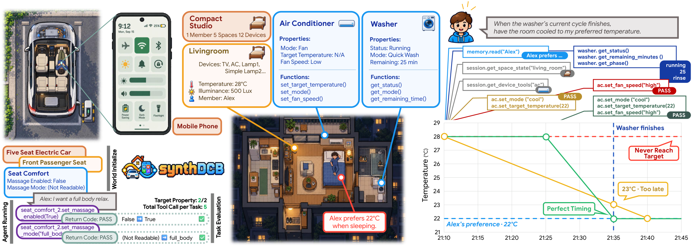
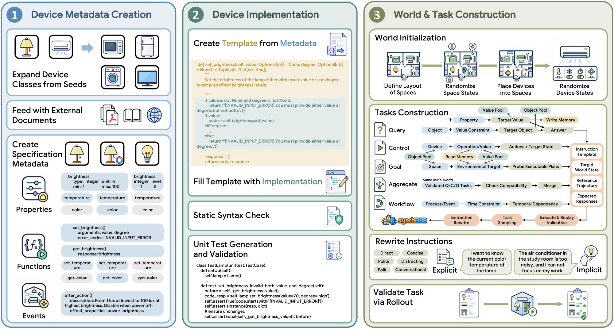

<div align="center">




**SynthDCB: World Distillation for Scalable Device Control Benchmarking**


</div>

## Overview

Scaling device-control evaluation requires scaling both the worlds agents interact with and the tasks they must solve. We introduce **SynthDCB**, a scalable benchmark for environment awareness and device control built through **world distillation**. World distillation transforms knowledge of device behaviors, interaction constraints, and environmental effects into modular executable components, which are composed into interactive worlds with explicit states, actions, and temporal dynamics. A unified capability representation connects tool discovery, world execution, and task synthesis, allowing new capabilities to enter evaluation through a shared construction pipeline. SynthDCB instantiate Home, Car, and Phone domains with 114 device classes, 1,166 functions, and 95 events, supporting 5 task families with 32 subtypes. The stateful design enables efficient task validation and agent evaluation through state correctness and tool-call traces. We evaluate seven models on 2,560 test tasks; the best achieves 68.2% Pass@1. Error analysis reveals challenges in answer delivery, feasibility diagnosis, and temporal coordination. Construction experiments demonstrate scalability across domains and token efficiency, world distillation reduces token consumption by 0.9–66.0% and 46.2–92.5% relative to Codex low and xhigh, while achieving broader capability coverage. SynthDCB makes executable world construction the basis of scalable device-control benchmarking, connecting an expanding space of capabilities and interactions to verifiable agent evaluation.

## Pipeline



## Data and Code

🚧 **Data and code coming soon.**

## Citation

If you find this work useful, please cite:

```bibtex
@misc{zhu2026synthdcb,
  author = {Zhu, Zichen and Liu, Dingye and Jiang, Nan and Zhang, Danyang and Zheng, Hang and Zheng, Shijie and Zhang, Situo and Lan, Kunyao and Ma, Yingzi and Jiang, Sheng and Chen, Lu and Yu, Kai},
  title = {SynthDCB: World Distillation for Scalable Device Control Benchmarking},
  year = {2026},
  url = {https://github.com/X-LANCE/SynthDCB}
}
```
