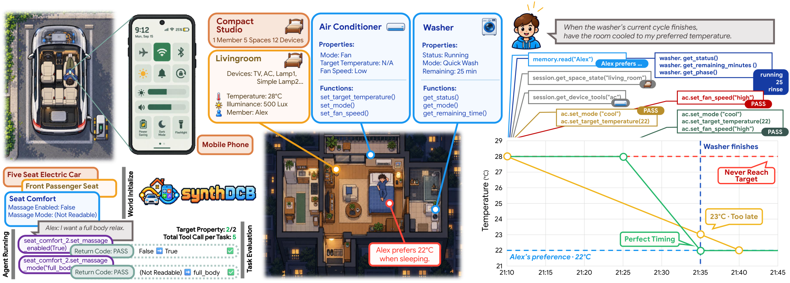

<div align="center">




**SynthDCB: World Distillation for Scalable Device Control Benchmarking**

[](https://x-lance.github.io/SynthDCB/)
[](https://arxiv.org/abs/2611.18639)
[](https://github.com/X-LANCE/SynthDCB)
[](https://huggingface.co/datasets/JamesZhutheThird/SynthDCB)

</div>

## Overview

Scaling device-control evaluation requires scaling both interactive worlds and the tasks agents must solve. We introduce **SynthDCB**, a benchmark for environment awareness and device control built through **world distillation** (WD). World distillation transforms knowledge of device behaviors, constraints, and environmental effects into modular executable components. A unified capability representation connects tool discovery, world execution, and task synthesis. SynthDCB instantiates Home, Car, and Phone with 114 device classes, 1,166 functions, and 95 events, supporting five task families with 32 subtypes. Explicit states and tool-call traces support task validation and agent evaluation. We evaluate 22 models on 2,560 test tasks; the best achieves 88.8% mean Pass@1. Construction experiments demonstrate token efficiency and expansion of task coverage. At the richest knowledge level, WD fully covers 22/23 properties, 19/29 functionalities, and 30/39 event requirements specified in a real RobotVacuum protocol. Furthermore, the 1,000 sampled tasks semantically cover 81.6% of the 854 reference instructions in the real-world corpus. SynthDCB connects an expanding space of real-to-sim executable capabilities to verifiable agent evaluation.

## Setup and data

Run the following from the repository root with Python 3.14.

```bash
python -m venv .venv
source .venv/bin/activate
python -m pip install -r requirements.txt
hf download JamesZhutheThird/SynthDCB --repo-type dataset --include 'data/*' --local-dir .
```

The download places 314 validation tasks in `data/valid/`, 2,560 test tasks in `data/test/`, and 130 source worlds in `data/world/`. Each domain has a `tasks.list` for each split. Each task directory contains its own initial world, instruction, targets, and reference trajectory. The matching device implementations and layouts are in `simulator/devices/` and `simulator/domains/`.

## Evaluation

Replay a stored trajectory locally to check the simulator and scoring.

```bash
TASK=data/valid/Home/task_0f4e4b21
python -m src.cli.evaluate_dataset reference \
  --task_path "$TASK" --world_path "$TASK" \
  --domain_path simulator/devices/Home --run_id home_reference
```

Set `OPENAI_API_KEY` in your shell or a local `.env` file for model evaluation. `OPENAI_MODEL` selects the model for generation and evaluation (default `gpt-6-luna`). The memory and failure-report judges use the same model unless you set `DCB_JUDGE_MODEL`. To use another compatible API, set `OPENAI_BASE_URL` and choose `chat` (default) or `responses` with `DCB_API_PROTOCOL`.

```bash
python -m src.cli.evaluate_dataset run \
  --task_path data/test/Home/tasks.list --domain_path simulator/devices/Home \
  --agent_strategy react --style conversational --samples_per_instruction 1 \
  --max_turns 20 --num_workers 4
```

Use `Car` or `Phone` in both paths for the other domains. Add `--max_tasks 1 --dry_run` to check a split without model calls. Use `--agent_strategy toolcall` for native tool calling. Runs write to `results/` by default.

## Generation

`src/cli/generate_environment.py` builds device lists and implementations. Optional retrieval reads user-supplied sources via `DCB_RAG_SOURCE_CONFIG`. Running generated device tests requires Linux with `unshare` and `bwrap` enabled.

Generate worlds and tasks from the released models with a domain's scenario plan. The plan specifies the random seed, world count, sampling profile and output paths.

```bash
python -m src.cli.generate_scenarios --plan simulator/domains/Home/scenario_plan.json
```

Use `python -m src.cli.select_tasks --help` for sampling from a generated task pool. The prompts for generation, agents, and judges are defined alongside their implementations in `src/`.

## Licenses

The SynthDCB source code, prompts, simulator, and device models use the Apache License 2.0. The benchmark tasks, source worlds, and dataset views on Hugging Face use Creative Commons Attribution 4.0 International.

[](LICENSE)
[](LICENSE-DATA)

## Citation

```bibtex
@misc{zhu2026synthdcb,
      title={Synth{DCB}: World Distillation for Scalable Device Control Benchmarking},
      author={Zichen Zhu and Dingye Liu and Nan Jiang and Danyang Zhang and Hang Zheng and Shijie Zheng and Situo Zhang and Kunyao Lan and Yingzi Ma and Sheng Jiang and Lu Chen and Kai Yu},
      year={2026},
      eprint={2611.18639},
      archivePrefix={arXiv},
      primaryClass={cs.LG},
      url={https://arxiv.org/abs/2611.18639},
}
```
