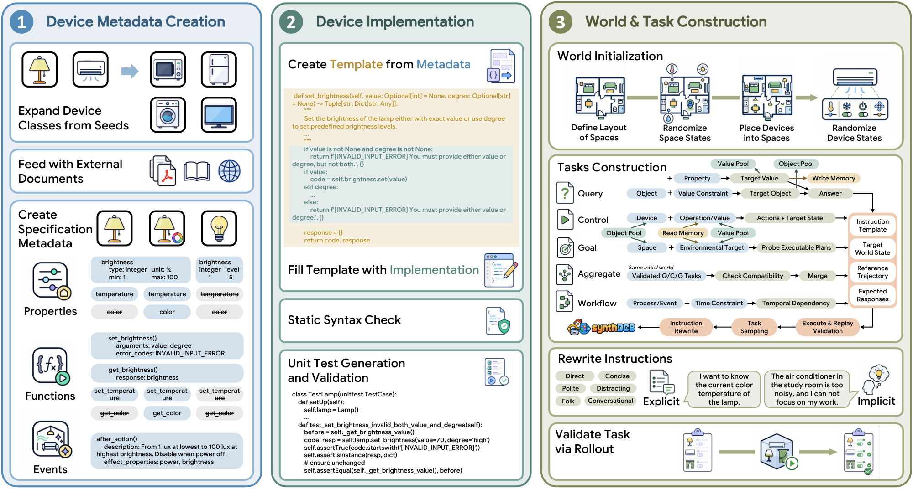

---
configs:
  - config_name: default
    data_files:
      - split: valid
        path: viewer/valid.json
      - split: test
        path: viewer/test.json
---

<div align="center">


**SynthDCB: World Distillation for Scalable Device Control Benchmarking**

🌐 [Project Page](https://x-lance.github.io/SynthDCB/) · [arXiv](https://arxiv.org/abs/2611.18639)


</div>

## Overview

Scaling device-control evaluation requires scaling both interactive worlds and the tasks agents must solve. We introduce **SynthDCB**, a benchmark for environment awareness and device control built through **world distillation** (WD). World distillation transforms knowledge of device behaviors, constraints, and environmental effects into modular executable components. A unified capability representation connects tool discovery, world execution, and task synthesis. SynthDCB instantiates Home, Car, and Phone with 114 device classes, 1,166 functions, and 95 events, supporting five task families with 32 subtypes. Explicit states and tool-call traces support task validation and agent evaluation. We evaluate 22 models on 2,560 test tasks; the best achieves 88.8% mean Pass@1. Construction experiments demonstrate token efficiency and expansion of task coverage. At the richest knowledge level, WD fully covers 22/23 properties, 19/29 functionalities, and 30/39 event requirements specified in a real RobotVacuum protocol. Furthermore, the 1,000 sampled tasks semantically cover 81.6% of the 854 reference instructions in the real-world corpus. SynthDCB connects an expanding space of real-to-sim executable capabilities to verifiable agent evaluation.

## Pipeline



## Data and Code

🚧 **Data and code coming soon.**

## Citation

If you find this work useful, please cite:

```bibtex
@misc{zhu2026synthdcbworlddistillationscalable,
      title={SynthDCB: World Distillation for Scalable Device Control Benchmarking},
      author={Zichen Zhu and Dingye Liu and Nan Jiang and Danyang Zhang and Hang Zheng and Shijie Zheng and Situo Zhang and Kunyao Lan and Yingzi Ma and Sheng Jiang and Lu Chen and Kai Yu},
      year={2026},
      eprint={2611.18639},
      archivePrefix={arXiv},
      primaryClass={cs.LG},
      url={https://arxiv.org/abs/2611.18639},
}
```
